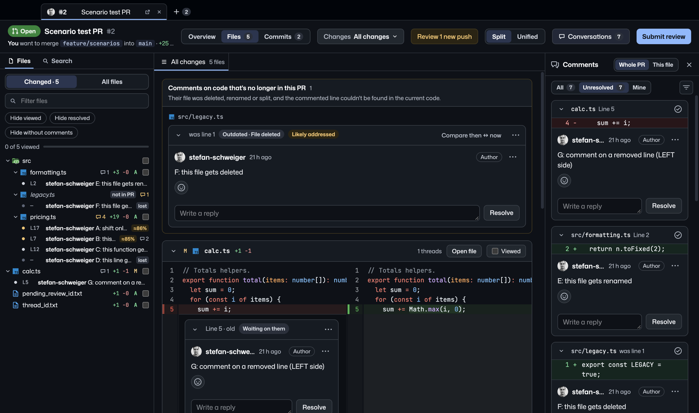

# PR Review

A macOS app for reviewing GitHub pull requests in your own checkout.



PR Review opens each pull request in a git worktree of a clone you already have, shows the changes the way github.com does, and keeps review comments attached to the code as the pull request changes. Your review stays on your Mac until you submit it.

## What it does

- **Your checkout, not a browser tab.** Every pull request gets its own worktree next to your clone, so you can build, run and search the code. The whole repository is a click away, not just the changed files.
- **Comments that follow the code.** When the pull request changes (lines move, files are edited, renamed or split), threads are placed again in the current code, with a confidence label when they had to be found by their content.
- **Review what's new.** One click shows only what changed since your last review, or since any push or commit.
- **Drafts stay local** until you submit them as one review: comment, approve or request changes.
- **Find in files** (⇧⌘F), like VS Code: match case, whole word, regular expressions, files to include or exclude, results as a list or a tree.
- **Triage.** See which threads wait for your reply and which look addressed by later changes.
- **Act on it.** Merge with GitHub's rules and proposed commit message, request reviewers, close or reopen, switch between draft and ready.
- **Quick actions:** your own commands for a pull request (say, `claude "/code-review $PR_NUMBER"` or `npm test`), run in its worktree, in iTerm2 or another terminal, or in the background.
- **Find** in the current view (⌘F), in both versions of a diff or one.
- **Tabs** for several pull requests (drag to reorder, pop out into windows), restored when you restart.
- **Stays current.** The open pull request is checked for new pushes, comments and reviews every 45 seconds.
- **Themes**: GitHub Dark, Light and High Contrast, and Slate; any of Shiki's code themes; your choice of fonts and sizes.
- **Opens GitHub links** (optional): a browser extension for Chrome or Edge opens GitHub pull request links in the app.

## Install

You need a Mac with Apple silicon, **git**, and ideally the **GitHub CLI** signed in (`brew install gh`, then `gh auth login`).

1. Download `pr-review-<version>-arm64.dmg` from the [latest release](https://github.com/stefan-schweiger/pr-review/releases/latest), open it and drag **PR Review** into Applications.
2. The app isn't notarized by Apple (that takes a paid developer account), so macOS blocks the first launch. Open it once, then click **Open Anyway** in **System Settings › Privacy & Security**. Or, in Terminal:
   ```sh
   xattr -dr com.apple.quarantine "/Applications/PR Review.app"
   ```
3. The first launch walks you through the setup: GitHub sign-in, the folders that hold your clones, where worktrees go, your editor and a theme. You can run it again from Settings (⌘,).

### Signing in

PR Review uses your GitHub CLI login: if `gh auth status` shows you're signed in, there's nothing to do. Without the GitHub CLI you can sign in with your own [GitHub OAuth app](https://docs.github.com/en/apps/oauth-apps/building-oauth-apps/creating-an-oauth-app) that has device flow enabled; paste its client ID in the setup or in Settings. That token is saved encrypted, with a key kept in your macOS keychain.

### Opening pull requests from GitHub (Chrome, Edge)

Load the extension once:

1. Open `chrome://extensions` (in Edge, `edge://extensions`) and turn on **Developer mode**.
2. Drag the extension folder onto that page. Or click **Load unpacked** and pick the folder; it's inside the app, so press ⇧⌘G in the picker and paste its path.

Settings › Open pull requests from GitHub shows the folder's path, with **Copy path** and **Show in Finder**, and opens the extensions page for you. Every release also has the extension as a zip.

From then on, GitHub pull request links open in PR Review, whether you click them on github.com or open them from Slack, Mail or anywhere else. The browser asks "Open PR Review?" the first time; tick "Always allow". The extension's toolbar button turns automatic opening on or off, for all repositories or one at a time, and there's an **Open in PR Review** button on pull request pages.

## Privacy

- The app talks to the GitHub API with your token, and to nothing else of its own. There's no telemetry.
- The default fonts (Mona Sans and JetBrains Mono) load from Google Fonts. Clear both font fields in Settings to use the bundled fonts instead.
- Placing comments with AI is off by default. When you turn it on, it runs your local Claude Code CLI for comments it can't place on its own.

## Development

```sh
npm install
npm run dev         # the app, reloading as you edit
npm run typecheck
npm test            # unit tests (vitest)
npm run e2e         # end-to-end test against a mock GitHub (Playwright)
```

The app is Electron with React, built by electron-vite; diffs come from [@pierre/diffs](https://www.npmjs.com/package/@pierre/diffs). `src/main` runs the pull request sessions, `src/renderer` is the interface, and `src/core` holds the git, GitHub and comment-placing logic, tested without Electron.

Useful when testing: `PR_REVIEW_USER_DATA=<folder>` runs with a separate profile (and doesn't claim `prreview://` links), and `PR_REVIEW_HIDDEN_WINDOWS=1` keeps windows off screen.

## Releasing

1. Raise `version` in `package.json` and rename `CHANGELOG.md`'s `## Unreleased` section to `## <version>` (changes collect there as they're made), then commit and push.
2. Run `npm run release:publish`. It typechecks, runs the tests, builds `pr-review-<version>-arm64.dmg`, zips the browser extension, writes `SHA256SUMS.txt` (all in `dist/release-<version>/`) and creates a **draft** GitHub release `v<version>` with those files, that version's changelog and install notes.
3. Look over the draft on GitHub and publish it.

`npm run release` builds the same files without creating a release.

The app is ad-hoc signed. To ship a notarized app, give electron-builder a Developer ID certificate and notarization credentials (see its [code signing docs](https://www.electron.build/code-signing-mac)).

## License

[MIT](LICENSE). Bundled: [Material Icon Theme](https://github.com/material-extensions/vscode-material-icon-theme) file icons, [Octicons](https://github.com/primer/octicons) and the [Hydra](https://github.com/juanmnl/vs-hydra) code theme, each under the MIT License (their notices are in the app under Settings › Acknowledgements).
